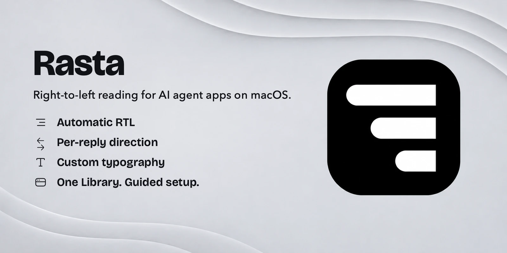
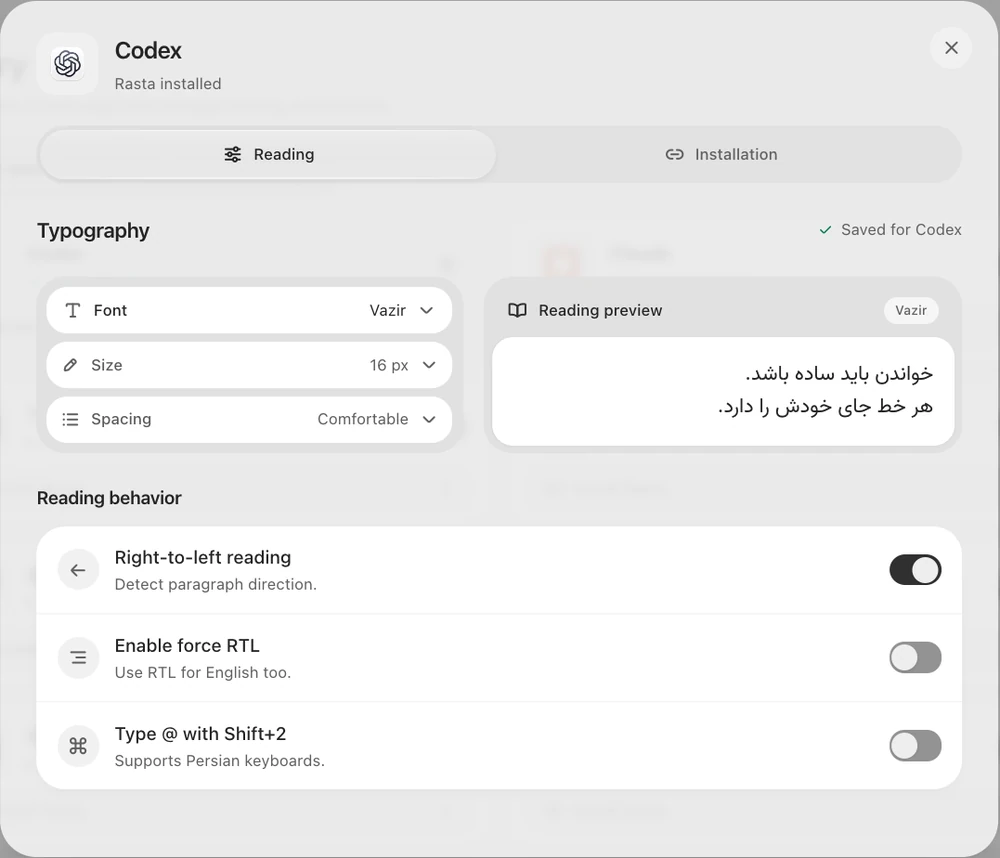

  

<!-- badges:start -->

<!-- badges:end -->

Read Persian, Arabic, and mixed-direction conversations in macOS AI agent apps. Rasta adds automatic RTL, per-reply direction, and custom typography.

## Rasta in action

  

## Install on macOS

Rasta 1.0.0 supports Apple Silicon Macs running macOS 13.5 or later. Rasta Library includes Codex, T3 Code, Antigravity, Claude, OpenCode, ZCode, Grok Bot, and Gemini.

1. Download Rasta for [Apple Silicon (M-series)](https://github.com/amirmahdinezhad/rasta/releases/download/v1.0.0/Rasta-1.0.0-darwin-arm64.dmg), or browse [GitHub Releases](https://github.com/amirmahdinezhad/rasta/releases).
2. Open the DMG and drag **Rasta.app** into **Applications**.
3. Open **Rasta → Library**, turn on the connection for your app, and choose **Launch** when preparation finishes.

If macOS blocks the first launch of a trusted ad hoc signed copy, open **System Settings → Privacy & Security** and choose **Open Anyway** for Rasta.

## Updates

Open **Settings → Rasta app updates** to check for Rasta app updates. For a connection update, open the app card in **Library** and use **Installation** to prepare the available package. Choose **Launch** when ready.

If you already have a higher-numbered Rasta version, use the DMG to install Rasta 1.0.0 manually. To replace an earlier test build or move a higher-numbered connection to 1.0.0, open its **Installation** tab in Library, choose **Install bundled Rasta 1.0.0**, then choose **Launch**.

## Remove Rasta

In **Library**, use the connection card’s trash button and confirm. This restores the original host app and removes that connection’s Rasta settings and imported fonts. To remove the manager too, quit Rasta and move **Rasta.app** to the Trash after removing your connections.

## License

Rasta uses the [MIT License](LICENSE). Vazir uses the [SIL Open Font License](bin/assets/Vazir-OFL.txt).

## راهنمای فارسی

راستا خواندن متن فارسی، عربی و چندزبانه را در برنامه‌های عامل هوش مصنوعی روی مک آسان‌تر می‌کند. جهت متن خودکار تشخیص داده می‌شود و می‌توانید جهت هر پاسخ و تنظیمات فونت را تغییر دهید.

### نصب روی مک

راستا 1.0.0 روی مک‌های Apple Silicon با **macOS 13.5 یا جدیدتر** اجرا می‌شود. در Library می‌توانید به Codex،‏ T3 Code،‏ Antigravity،‏ Claude،‏ OpenCode،‏ ZCode،‏ Grok Bot و Gemini متصل شوید.

1. فایل DMG راستا را برای [Apple Silicon (سری M)](https://github.com/amirmahdinezhad/rasta/releases/download/v1.0.0/Rasta-1.0.0-darwin-arm64.dmg) دانلود کنید یا [نسخه‌های GitHub](https://github.com/amirmahdinezhad/rasta/releases) را ببینید.
2. فایل DMG را باز کنید و **Rasta.app** را به پوشهٔ **Applications** بکشید.
3. راستا را باز کنید، در **Library** اتصال برنامهٔ موردنظرتان را روشن کنید و پس از آماده‌شدن **Launch** را بزنید.

اگر macOS جلوی اجرای اول نسخه‌ای با امضای محلی را گرفت و به نسخه‌ای که دانلود کرده‌اید اعتماد دارید، در **System Settings → Privacy & Security** برای راستا **Open Anyway** را بزنید.

### به‌روزرسانی

برای به‌روزرسانی خود راستا، در **Settings** بخش **Rasta app updates** را باز کنید. برای به‌روزرسانی یک اتصال، کارت آن برنامه را در **Library** باز کنید و بسته را از بخش **Installation** آماده کنید. سپس **Launch** را بزنید.

اگر نسخه‌ای با شمارهٔ بالاتر دارید، نسخهٔ 1.0.0 راستا را با DMG دستی نصب کنید. برای جایگزینی نسخهٔ آزمایشی قبلی یا برگرداندن اتصال به 1.0.0، در **Library** بخش **Installation** آن اتصال را باز کنید، **Install bundled Rasta 1.0.0** را بزنید و سپس **Launch** را انتخاب کنید.

### حذف راستا

در **Library** دکمهٔ سطل زبالهٔ کارت اتصال را بزنید و تأیید کنید. نسخهٔ اصلی برنامه بازگردانده می‌شود و تنظیمات و فونت‌های اضافه‌شدهٔ راستا برای همان برنامه حذف می‌شوند. برای حذف خود راستا، بعد از حذف اتصال‌ها از برنامه خارج شوید و **Rasta.app** را به سطل زباله منتقل کنید.

